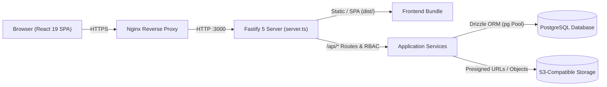

# EduCoreLMS — Politeknik Kampar Learning Management System

**EduCoreLMS** is the official Academic Learning Management System developed for **Politeknik Kampar**. It provides an integrated digital platform for academic period administration, digital classrooms, learning materials, assignments, assessments, role-based access control (RBAC), institutional branding, system auditing, and an internal Knowledge Center.

---

## Table of Contents

- [Project Overview](#project-overview)
- [Key Features](#key-features)
- [User Roles & RBAC](#user-roles--rbac)
- [Technology Stack](#technology-stack)
- [System Architecture](#system-architecture)
- [Prerequisites](#prerequisites)
- [Local Development Installation](#local-development-installation)
- [Database Seeding](#database-seeding)
- [Environment Configuration](#environment-configuration)
- [Application Modes](#application-modes)
- [Production Deployment (Linux + Nginx + HTTPS)](#production-deployment-linux--nginx--https)
- [Updating Production](#updating-production)
- [Database Backup & Recovery](#database-backup--recovery)
  - [Superadmin Emergency Account Recovery (`scripts/recover-superadmin.ts`)](#superadmin-emergency-account-recovery-scriptsrecover-superadmints)
- [Troubleshooting](#troubleshooting)
- [Security Best Practices](#security-best-practices)
- [Project Directory Structure](#project-directory-structure)
- [Development Guidelines](#development-guidelines)
- [Project Roadmap](#project-roadmap)
- [License & Copyright](#license--copyright)

---

## Project Overview

EduCoreLMS serves as the unified academic portal for Politeknik Kampar, supporting lecturers (*Dosen*), students (*Mahasiswa*), institutional auditors (*Auditor*), and system administrators (*Superadmin*).

### Core Objectives

- Centralize digital classroom workflows, course materials, assignments, and online assessments.
- Enforce strict Role-Based Access Control (RBAC) with complete read-only isolation for the `AUDITOR` role.
- Provide institutional-grade security with Argon2 password hashing, HTTP-only session cookies, CSRF protection, password policies, and immutable audit logging.
- Allow dynamic institutional branding, academic color presets, and metadata configuration through System Settings.
- Provide a built-in Knowledge Center for operational documentation across all roles.

---

## Key Features

| Module / Feature | Status | Description |
| :--- | :--- | :--- |
| **Authentication & Session Security** | Implemented | Session-based authentication with Argon2id hashing, HTTP-only cookies, CSRF checks, and forced password change flows. |
| **User Management & Bulk Import** | Implemented | Account lifecycle management, role assignment, account activation/deactivation, and Excel (`.xlsx`) / bulk user workflows. |
| **Role-Based Access Control (RBAC)** | Implemented | Granular permission matrix across 4 canonical roles (`SUPERADMIN`, `DOSEN`, `MAHASISWA`, `AUDITOR`) with dedicated RBAC management UI. |
| **Academic Period Management** | Implemented | Management of academic years, semesters, and active period states. |
| **Digital Classrooms & Wizard** | Implemented | Multi-step Classroom Builder Wizard, participant management, CPMK mapping, cover images, and per-classroom settings. |
| **Learning Materials** | Implemented | Rich-text material builder (Tiptap) and structured material viewer with attachments and completion tracking. |
| **Assignments & Grading** | Implemented | Assignment builder, student submission workspace, lecturer grading interface, and monitoring dashboards. |
| **Assessments & Examination Engine** | Implemented | Advanced assessment builder, timed student examination view, automated grading engine, essay grading, and live monitoring. |
| **System Settings & Global Branding** | Implemented | Superadmin configuration for institutional identity, logos, favicons, SEO metadata, and global color presets. |
| **Audit Logs** | Implemented | Activity and security audit trail viewer for Superadmin and Auditor inspection. |
| **Knowledge Center** | Implemented | Built-in help & documentation portal with role-specific guides and Superadmin article management. |
| **Superadmin Emergency Recovery CLI** | Implemented | Terminal-only recovery script (`scripts/recover-superadmin.ts`) with confirmation, password policy enforcement, and audit logging. |
| **S3-Compatible Object Storage** | Partial / Configurable | Integrated via `@aws-sdk/client-s3` and `@aws-sdk/s3-request-presigner`; requires valid S3 credentials and bucket configuration in production. |

---

## User Roles & RBAC

EduCoreLMS enforces four canonical user roles:

| Role | Access Level | Primary Responsibilities & Capabilities |
| :--- | :--- | :--- |
| **`SUPERADMIN`** | Full System Administration | Manages users, RBAC permissions, academic periods, system settings, institutional branding, Knowledge Center articles, and audit logs. |
| **`DOSEN`** | Academic Author & Instructor | Creates and manages digital classrooms, learning materials, assignments, and assessments; grades submissions and essays; monitors student progress. |
| **`MAHASISWA`** | Learner | Joins/views enrolled classrooms, reads learning materials, submits assignments, completes online assessments/examinations, and views personal grades. |
| **`AUDITOR`** | **Strict Read-Only Everywhere** | Inspects classrooms, materials, assignments, assessments, monitoring dashboards, user directories, and audit logs. **All write, edit, delete, submit, grade, and state-mutating actions are blocked at both UI and API layers.** |

---

## Technology Stack

Verified directly from [package.json](file:///home/mahdi-nk/Project/EduCoreLms/package.json):

### Frontend

- **React** (`^19.0.1`) & **React DOM** (`^19.0.1`)
- **TypeScript** (`^7.0.2`)
- **Vite** (`^8.3.0`) & `@vitejs/plugin-react` (`^6.1.1`)
- **Tailwind CSS** (`^4.3.3`) via `@tailwindcss/vite`
- **React Router DOM** (`^7.18.5`)
- **TanStack React Query** (`^5.107.1`)
- **React Hook Form** (`^7.92.0`) & **Zod** (`^4.6.7`)
- **Tiptap Rich Text Editor** (`^3.33.1` extensions, `lowlight` `^3.3.0`)
- **UI & Utilities**: `lucide-react` (`^0.546.0`), `motion` (`^12.23.24`), `sonner` (`^2.0.8`), `clsx`, `tailwind-merge`, `class-variance-authority`

### Backend & Storage

- **Fastify** (`^5.12.8`) with `@fastify/cookie`, `@fastify/cors`, `@fastify/middie`, `@fastify/multipart`, `@fastify/static`
- **PostgreSQL** (`pg` `^8.23.1`)
- **Drizzle ORM** (`^0.45.4`) & **Drizzle Kit** (`^0.31.11`)
- **Security**: `argon2` (`^0.45.2`)
- **Media & Document Processing**: `sharp` (`^0.35.5`), `mammoth` (`^1.13.0`), `xlsx` (`^0.18.5`)
- **Object Storage**: `@aws-sdk/client-s3` (`^3.1167.0`), `@aws-sdk/s3-request-presigner` (`^3.1167.0`)
- **AI SDK**: `@google/genai` (`^2.4.0`)

### Testing & Tooling

- **Vitest** (`^5.1.0`)
- **TSX** (`^4.21.0`) for TypeScript execution in development

---

## System Architecture

In development, `server.ts` runs Fastify with Vite middleware (`middlewareMode: true`) on a single HTTP server and port. In production (`NODE_ENV=production`), `server.ts` serves the compiled Vite SPA bundle from `dist/` alongside `/api/*` routes.



---

## Prerequisites

Ensure the following tools are installed on your development or production machine:

- **Node.js** `>= 22.x` (required for native TypeScript execution in `node server.ts` or compatible runtime; `tsx` is also included for development)
- **npm** (or **Bun** — both `package-lock.json` and `bun.lock` are present; Bun is used for CLI scripts such as `bun run scripts/recover-superadmin.ts`)
- **PostgreSQL** `>= 15` (with a database and admin/runtime user configured)
- **Git**

---

## Local Development Installation

1. **Clone the repository:**

   ```bash
   git clone <repository-url>
   cd EduCoreLms
   ```

2. **Install dependencies:**

   ```bash
   npm install
   ```

   *(Or `bun install` if using Bun.)*

3. **Configure environment variables:**

   ```bash
   cp .env.example .env
   ```

   Update `.env` with your local PostgreSQL credentials and a development `SESSION_SECRET`.

4. **Push or migrate the database schema:**

   ```bash
   npm run db:push
   ```

   *(Or apply versioned SQL migrations from `drizzle/` using `npm run db:migrate`.)*

5. **Start the development server:**

   ```bash
   npm run dev
   ```

   The application will be available at `http://localhost:3000/`.

6. **Verify TypeScript and tests (optional):**

   ```bash
   npm run lint
   npm test
   ```

---

## Database Seeding

EduCoreLMS uses **automatic, idempotent lazy seeding** rather than a separate `npm run seed` script. After pushing or migrating the database schema (`npm run db:push` or `npm run db:migrate`), initial data is populated automatically when the application starts receiving API requests:

| Seed Module | Trigger Mechanism | What Gets Seeded |
| :--- | :--- | :--- |
| **`ensureSeeded()`** (`src/server/seed.ts`) | Automatically invoked via Fastify `preHandler` hook in `src/server/routes.ts` on the first request to `/api/v1/*` when the `roles` table is empty. | Canonical roles (`SUPERADMIN`, `DOSEN`, `MAHASISWA`, `AUDITOR`), RBAC permissions & role mappings, initial users & profiles, academic years/semesters, courses, classrooms, enrollments, materials, assignments, quizzes, gradebooks, and notifications. |
| **`ensureKnowledgeCenterSeeded()`** (`src/server/knowledgeSeed.ts`) | Automatically invoked on the first request to Knowledge Center routes (`src/server/knowledgeCenterRoutes.ts`) when categories/articles are empty. | Knowledge Center categories, tags, role-targeted documentation articles, FAQs, and initial article versions. |
| **`ensureSeededAssessmentsAndQuestionBanks()`** (`src/server/assessmentRoutes.ts`) | Automatically invoked when assessment routes are accessed and no assessment/question bank records exist. | Initial question banks and sample assessments. |

### How to Run Seeding

1. **Standard Method (Recommended):**
   Start the server (`npm run dev` or `npm run start`) and open `http://localhost:3000/` in your browser, or send a request to any `/api/v1/*` endpoint:

   ```bash
   curl -s http://localhost:3000/api/v1/auth/me
   ```

   If the database is empty, `ensureSeeded()` runs inside a PostgreSQL transaction and logs:
   `Politeknik Kampar LMS database seed completed successfully.`

2. **Direct CLI Trigger (Without Browser Traffic):**
   If you want to pre-populate the core seed and Knowledge Center data directly from the terminal during provisioning:

   ```bash
   npx tsx -e "import { ensureSeeded } from './src/server/seed.ts'; import { ensureKnowledgeCenterSeeded } from './src/server/knowledgeSeed.ts'; await ensureSeeded(); await ensureKnowledgeCenterSeeded(); process.exit(0);"
   ```

### Default Seeded User Accounts

When `ensureSeeded()` initializes an empty database, the following development user accounts are created in [src/server/seed.ts](file:///home/mahdi-nk/Project/EduCoreLms/src/server/seed.ts):

| Role | Name | Email | Default Password |
| :--- | :--- | :--- | :--- |
| `SUPERADMIN` | Ir. Hendra Pratama, M.Kom. | `superadmin@poltek-kampar.ac.id` | `AdminPolkam#2026` |
| `DOSEN` | Dr. Fitriani Syahrir, S.T., M.T. | `fitriani.dosen@poltek-kampar.ac.id` | `DosenPolkam#2026` |
| `DOSEN` | M. Ridwan Nasution, S.Kom., M.Cs. | `ridwan.dosen@poltek-kampar.ac.id` | `DosenPolkam#2026` |
| `MAHASISWA` | Ahmad Fauzan Al-Farisi | `ahmad.mhs@student.poltek-kampar.ac.id` | `MhsPolkam#2026` |
| `MAHASISWA` | Siti Rahmawati Putri | `siti.mhs@student.poltek-kampar.ac.id` | `MhsPolkam#2026` |
| `MAHASISWA` | Dimas Wahyu Saputra | `dimas.mhs@student.poltek-kampar.ac.id` | `MhsPolkam#2026` |

*(Note: The `AUDITOR` role is seeded in the `roles` table, but no default `AUDITOR` user account is created automatically. You can create an `AUDITOR` account via User Management while logged in as `SUPERADMIN`.)*

> **Security Note:** These credentials are for local development and initial setup only. In staging or production environments, change all initial passwords immediately after first login or rotate the Superadmin password using `scripts/recover-superadmin.ts`.

---

## Environment Configuration

All runtime and migration configuration is loaded via `dotenv` from `.env`. Never commit `.env` to version control.

| Variable | Required | Default | Description |
| :--- | :--- | :--- | :--- |
| `NODE_ENV` | Yes | `development` | Application mode (`development` or `production`). |
| `PORT` | No | `3000` | HTTP port on which Fastify listens (`0.0.0.0`). |
| `APP_URL` | Recommended | `http://localhost:3000` | Public base URL of the application. |
| `SQL_HOST` | Yes | — | PostgreSQL server hostname or IP (e.g., `127.0.0.1`). |
| `SQL_PORT` | Yes (for Drizzle) | `5432` | PostgreSQL TCP port (`1`–`65535`). |
| `SQL_DB_NAME` | Yes | — | Target PostgreSQL database name. |
| `SQL_USER` | Yes | — | PostgreSQL runtime application username. |
| `SQL_PASSWORD` | Yes | — | PostgreSQL runtime application password. |
| `SQL_ADMIN_USER` | Yes (for Drizzle) | — | PostgreSQL admin username used by `drizzle-kit`. |
| `SQL_ADMIN_PASSWORD` | Yes (for Drizzle) | — | PostgreSQL admin password used by `drizzle-kit`. |
| `SESSION_SECRET` | Yes (Prod) | Fallback dev key | Secret used to sign session cookies. **Must be a 64+ character random string in production.** |
| `S3_ENDPOINT` | For S3 storage | — | S3-compatible endpoint URL. |
| `S3_BUCKET` | For S3 storage | `poltek-kampar-lms-private` | Private S3 bucket name for file uploads/assets. |
| `S3_REGION` | For S3 storage | — | S3 region identifier (e.g., `ap-southeast-1`). |
| `GEMINI_API_KEY` | Optional | — | API key for Google Gemini AI SDK features (`@google/genai`). |
| `PASSWORD_MIN_LENGTH` | Optional | `12` | Minimum password length (clamped `>= 8`). |
| `PASSWORD_MAX_LENGTH` | Optional | `128` | Maximum password length (clamped `<= 256`). |
| `PASSWORD_HISTORY_COUNT` | Optional | `5` | Number of previous passwords remembered to prevent reuse. |
| `TEMP_PASSWORD_EXPIRATION_HOURS` | Optional | `24` | Expiration window for temporary/reset passwords. |
| `DISABLE_HMR` | Optional | `false` | Set to `true` to disable Vite HMR/file watching in development. |

---

## Application Modes

| Command | Mode | Description |
| :--- | :--- | :--- |
| `npm run dev` | Development | Runs `tsx server.ts` with Vite HMR middleware on `http://localhost:3000`. |
| `npm run build` | Build | Compiles the React frontend via `vite build` into `dist/`. |
| `npm run start` | Production | Runs `node server.ts` (`NODE_ENV=production` required to serve `dist/`). |
| `npm run preview` | Preview | Runs `vite preview` for static frontend inspection only (without Fastify API). |
| `npm run lint` | Typecheck | Runs `tsc --noEmit` across the project. |
| `npm test` | Testing | Runs the Vitest test suite (`vitest run`). |
| `npm run db:generate` | DB Tooling | Generates Drizzle SQL migrations into `drizzle/`. |
| `npm run db:migrate` | DB Tooling | Applies pending Drizzle migrations to PostgreSQL. |
| `npm run db:push` | DB Tooling | Pushes `src/db/schema.ts` directly to PostgreSQL. |
| `npm run db:studio` | DB Tooling | Opens Drizzle Studio for database inspection. |

---

## Production Deployment (Linux + Nginx + HTTPS)

### 1. Server Preparation

1. Provision an Ubuntu/Debian Linux server with **Node.js `>= 22`**, **PostgreSQL**, **Nginx**, and **Certbot**.
2. Create a dedicated system user (e.g., `educore`) and clone the repository to `/var/www/educore-lms`.
3. Create the PostgreSQL database and dedicated runtime/admin roles.

### 2. Environment & Build

1. Configure `/var/www/educore-lms/.env` with `NODE_ENV=production`, production database credentials, and a strong `SESSION_SECRET`:

   ```bash
   openssl rand -hex 32
   ```

2. Install dependencies, apply database migrations, and build the frontend:

   ```bash
   npm ci
   npm run db:migrate
   npm run build
   ```

### 3. Systemd Service (`/etc/systemd/system/educore-lms.service`)

```ini
[Unit]
Description=EduCoreLMS Politeknik Kampar
After=network.target postgresql.service

[Service]
Type=simple
User=educore
WorkingDirectory=/var/www/educore-lms
EnvironmentFile=/var/www/educore-lms/.env
ExecStart=/usr/bin/node /var/www/educore-lms/server.ts
Restart=always
RestartSec=5

[Install]
WantedBy=multi-user.target
```

Enable and start the service:

```bash
sudo systemctl daemon-reload
sudo systemctl enable --now educore-lms
sudo systemctl status educore-lms
```

### 4. Nginx Reverse Proxy & HTTPS

Create `/etc/nginx/sites-available/educore-lms`:

```nginx
server {
    listen 80;
    server_name lms.polkam.ac.id;

    client_max_body_size 50M;

    location / {
        proxy_pass http://127.0.0.1:3000;
        proxy_http_version 1.1;
        proxy_set_header Upgrade $http_upgrade;
        proxy_set_header Connection 'upgrade';
        proxy_set_header Host $host;
        proxy_set_header X-Real-IP $remote_addr;
        proxy_set_header X-Forwarded-For $proxy_add_x_forwarded_for;
        proxy_set_header X-Forwarded-Proto $scheme;
        proxy_cache_bypass $http_upgrade;
    }
}
```

Enable the site and issue an SSL certificate with Let's Encrypt:

```bash
sudo ln -s /etc/nginx/sites-available/educore-lms /etc/nginx/sites-enabled/
sudo nginx -t
sudo systemctl reload nginx
sudo certbot --nginx -d lms.polkam.ac.id
```

---

## Updating Production

To deploy updates safely:

```bash
cd /var/www/educore-lms
git pull origin main
npm ci
npm run db:migrate
npm run build
sudo systemctl restart educore-lms
```

Verify the service logs after restarting:

```bash
sudo journalctl -u educore-lms -n 50 --no-pager
```

---

## Database Backup & Recovery

### Automated PostgreSQL Backup (`pg_dump`)

Create a compressed backup of the production database:

```bash
pg_dump -h 127.0.0.1 -U postgres -F c -b -v -f "educore_backup_$(date +%Y%m%d_%H%M%S).dump" polkam_database
```

### Restoring from Backup (`pg_restore`)

```bash
pg_restore -h 127.0.0.1 -U postgres -d polkam_database --clean --if-exists -v educore_backup_YYYYMMDD_HHMMSS.dump
```

### Superadmin Emergency Account Recovery (`scripts/recover-superadmin.ts`)

If the primary Superadmin account is locked out or the password is forgotten, **do not** modify password hashes directly in PostgreSQL. Use the official server CLI script [scripts/recover-superadmin.ts](file:///home/mahdi-nk/Project/EduCoreLms/scripts/recover-superadmin.ts).

#### Prerequisites

- Execute the command on the application server (or local workspace) with a valid `.env` containing `SQL_HOST`, `SQL_USER`, `SQL_PASSWORD`, and `SQL_DB_NAME` (or `DATABASE_URL`).
- The target account must exist in `users`, hold the `SUPERADMIN` role, and have `isActive = true` with `accountStatus = 'ACTIVE'`.

#### Usage

Run the script using **Bun** or **TSX**, passing **only** the Superadmin email address:

```bash
bun run scripts/recover-superadmin.ts <superadmin-email>
```

*(Alternative using Node.js / TSX:)*

```bash
npx tsx scripts/recover-superadmin.ts <superadmin-email>
```

#### Step-by-Step Interactive Flow

1. **Environment & Target Validation:** The script verifies database environment variables, looks up the account by email, and confirms it is an active `SUPERADMIN` account. Invalid or unauthorized attempts are recorded in `audit_logs`.
2. **Account Identity Display & Confirmation:** The CLI prints `Nama`, `Email`, `Role`, and `Status`, then prompts for explicit confirmation:

   ```text
   Ketik RECOVER-SUPERADMIN untuk melanjutkan pemulihan:
   ```

   Type `RECOVER-SUPERADMIN` and press **Enter** to proceed.
3. **Cryptographic Recovery Execution:** Inside a database transaction, the script:
   - Generates a one-time cryptographic temporary password compliant with the configured password policy (`PASSWORD_MIN_LENGTH`, `PASSWORD_MAX_LENGTH`).
   - Hashes the password with **Argon2id** and records it in password history.
   - Revokes all active `user_sessions` (and impersonation sessions) for the account.
   - Enforces `mustResetPassword = true` with an expiration window (`TEMP_PASSWORD_EXPIRATION_HOURS`, default `24` hours).
   - Writes a `SUPERADMIN_PASSWORD_RECOVERY` event to `audit_logs`.
4. **Post-Recovery Login:**
   - Copy the **one-time temporary password** printed in the terminal immediately (it is never displayed again).
   - Log in at `/login` using the Superadmin email and temporary password.
   - Complete the mandatory password change screen to set a new permanent password.

> **Security Rule:** Never pass passwords or extra flags as CLI arguments to `scripts/recover-superadmin.ts`. The script strictly rejects commands with more than one argument (`process.argv.length > 3`).

---

## Troubleshooting

- **Database connection fails (`ECONNREFUSED` or auth error):**
  Verify PostgreSQL is running (`sudo systemctl status postgresql`) and that `SQL_HOST`, `SQL_PORT`, `SQL_DB_NAME`, `SQL_USER`, and `SQL_PASSWORD` in `.env` match your PostgreSQL configuration.
- **`drizzle-kit` fails with missing environment variables:**
  `src/db/drizzle.config.ts` requires `SQL_ADMIN_USER` and `SQL_ADMIN_PASSWORD` in addition to `SQL_HOST`, `SQL_PORT`, and `SQL_DB_NAME`.
- **Blank page in production (`NODE_ENV=production`):**
  Ensure `npm run build` has been executed so the `dist/` directory exists and contains `index.html`.
- **File uploads fail or exceed size limits:**
  Check Nginx `client_max_body_size` and verify S3 bucket credentials/permissions if S3 storage is enabled.
- **Session cookie not persisting over HTTP:**
  In `NODE_ENV=production`, secure cookies require HTTPS. Ensure Nginx terminates TLS and forwards `X-Forwarded-Proto $scheme`.

---

## Security Best Practices

- **Never commit `.env` files, database dumps, or private keys** to Git.
- Always generate a unique, high-entropy `SESSION_SECRET` (64+ characters) in production.
- Use separate PostgreSQL roles for runtime (`SQL_USER`) and schema migrations (`SQL_ADMIN_USER`).
- Keep `NODE_ENV=production` enabled on production servers so stack traces and Vite dev middleware are disabled.
- Always serve production traffic behind HTTPS with HSTS enabled via Nginx.
- Never bypass RBAC or audit logs by editing records directly in SQL; use official application UIs or `scripts/recover-superadmin.ts`.

---

## Project Directory Structure

```text
EduCoreLms/
├── drizzle/                # Generated Drizzle SQL migrations & metadata
├── public/                 # Static public assets (favicon.ico, favicon.svg)
├── scripts/
│   └── recover-superadmin.ts   # Official Superadmin emergency recovery CLI
├── src/
│   ├── components/         # Reusable UI, layout, modal, and editor components
│   ├── context/            # React contexts (Auth, Branding/Theme, etc.)
│   ├── db/                 # Drizzle config, PostgreSQL pool, schema, users
│   ├── hooks/              # Custom React hooks
│   ├── lib/                # Frontend utilities and API clients
│   ├── pages/              # Role-based pages (Dashboards, Classrooms, Assessments, etc.)
│   ├── server/             # Fastify app, route modules, security, RBAC, storage, seeding
│   ├── tests/              # Vitest API & integration tests
│   ├── App.tsx             # Frontend router & application shell
│   ├── index.css           # Global Tailwind CSS & theme tokens
│   └── main.tsx            # React entry point
├── .env.example            # Template for environment variables
├── .gitignore              # Git ignore rules (keeps README.md tracked)
├── package.json            # Dependencies and npm scripts
├── server.ts               # Unified Fastify + Vite (dev) / static (prod) entrypoint
├── tsconfig.json           # TypeScript configuration
└── vite.config.ts          # Vite bundler configuration
```

---

## Development Guidelines

1. **Type Safety:** Run `npm run lint` (`tsc --noEmit`) before committing changes.
2. **Database Changes:** Modify `src/db/schema.ts`, generate migrations with `npm run db:generate`, and apply with `npm run db:migrate`.
3. **RBAC Compliance:** Every new API endpoint must enforce role checks via server middleware (`src/server/security.ts`) and respect `AUDITOR` read-only restrictions.
4. **Testing:** Add or update tests in `src/tests/` and run `npm test` to verify behavior.

---

## Project Roadmap

- Complete end-to-end verification and production hardening of S3-compatible object storage workflows. *(Planned / In Progress)*
- Expand automated Vitest coverage across all classroom, assignment, and assessment API routes. *(Planned)*
- Continuous UI/UX refinements and Knowledge Center documentation updates as new academic modules are introduced. *(Ongoing)*

---

## License & Copyright

© Politeknik Kampar. License and distribution terms are managed by Politeknik Kampar.
